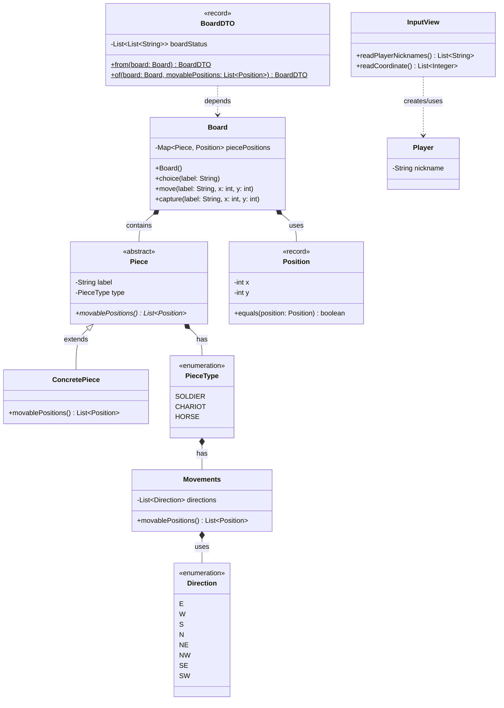

# 🚀 미션 2-1 : 장기

---

# `1. 사전 학습`

> 장기판 초기화를 어떻게 구현할지 설계해본다. 토론 활동의 재료를 만드는 단계.

- Q. 장기판의 상태는 무엇인가?
- A. 기물의 위치, _진행된 턴 수?_
- Q. 기물의 상태는 무엇인가?
- A.
    - 종류
    - 식별자?(같은 종류의 기물이 여러개다 - 위치만으로 특정 가능한가?)
- Q. 상태를 어떤 객체가 관리해야 하는가?
- A. 그 상태의 主 인 객체. == _주체 분리해서 관리?_
- Q. 불변과 캡슐화는 왜 필요한가?
- A.
    - 불변성 : 그 객체에 대한 신뢰
    - 캡슐화 : 그 객체에 대한 분리(은닉)
- Q. 기물마다 다른 이동 규칙을 어떻게 처리하는가?
- A. 이동이라는 행위는 인터페이스로 분리해서 구현. 다형성 호출로 이동 경우의 수
- Q. 조건문(if/switch)은 언제 `어떤` 문제가 되는가?
- A. 조건이 변경되거나 추가될 때. 과도한 코드 수정을 유발
- Q. 다형성은 어떤 문제를 해결하는가?
- A. 분기의 처리를 깔끔하게(조건문 없이) 하고, 기능의 확장이나 새로운 요소의 추가에 원활히 대응
- Q. 새 기물을 추가할 때 변경 범위를 어떻게 최소화하는가?
- A. 각 기물의 책임을 명확히 분리하고, 기물의 행위는 인터페이스로 분리, 기물에 대한 접근을 다형성 호출로 처리

## 키워드

| 목적`주제` | 키워드                   |
|--------|-----------------------|
| 게임 요소  | 장기, 보드, 기물, 초기        |
| 게임 구현  | 규칙, 구조, 종류, 배치        |
| 상태 모델링 | 불변 객체, 방어적 복사         |
| 이동 규칙  | 기물(차,마,상,사,장,포,졸)별 이동 |
| 다형성    | 인터페이스, 추상 클래스, 오버라이딩  |

> 게임 관련 키워드 : 모르는 내용과 기본 개념을 학습. `인지` 수준, 실험 먼저  
> 구현 관련 키워드 : 왜 언급되었을지, 프로그램 구현에 어떻게 활용할지 분석 및 예상

## **실험1: 보드 초기화 설계**

### **해볼 것**

> 코드를 작성하지 않고, **설계만** 해본다

- [x] 장기판을 어떻게 표현할 것인가?
- [x] 기물을 어떻게 표현할 것인가?
- [x] 초기 배치를 어떻게 설정할 것인가?

### **관찰할 것**

|              질문              |        초기 답변         |                       변경된 답변                        |
|:----------------------------:|:--------------------:|:---------------------------------------------------:|
| `장기판`은<br/>어떤 자료구조로 표현할 것인가? | 그래프<br/>이동을 위한 연결 확인 | 2차원 배열 [`캐모`]()<br/>연결 확인이 불필요(대각선)<br/>좌표 직접 접근 이동 |
|    `기물`은<br/>어떤 정보를 가지는가?    |  표시명<br/>이동 가능한 위치   |                  종류 <br/>이동 방법(전략)                  |
|      `위치 정보`는 누가 관리하는가?      |  보드? 기물? `매핑 테이블`?   |                         보드                          |
|       빈 칸은 어떻게 표현하는가?        |         빈 노드         |                        빈 배열                         |

# **[결과](#설계-초안-자료구조-클래스-구상)**

---

## **실험2: 상태 분류**

### **해볼 것**

- [x] 장기 게임에서 `변하는 정보`와 `변하지 않는 정보`를 분류한다.

### **관찰할 것**

| 변하는 정보(상태) | 변하지 않는 정보(상수?) |
|:----------:|:--------------:|
|   기물의 위치   |     보드의 크기     |
|   기물의 생사   |     좌표의 범위     |
|   참가자 차례   |     참가자 인수     |
|   참가자 승패   |     참가자 이름     |
|            |     기물의 이름     |
|            |     기물의 종류     |
|            |     기물의 소속     |
|            |     기물의 이동     |
|            |    `게임의 규칙`    |

- 게임의 규칙
    - 같은 좌표에 도달한다면
        - 동일한 플레이어의 기물이라면 이동 불가
        - 상이한 플레이어의 기물이라면 기물 포획
    - 이동 경로에 다른 기물이 있다면 이동 불가


- 해당 기물의 소유자(플레이어)를 어떻게 저장하고 판별할 것인가?
- 플레이어가 기물을 관리하게?
    - 책임 이관이 너무 훅넘어감
- 라벨과 플레이어 닉네임을 매핑?
    - 책임 분리가 과도함
- 플레이어에도 팀(초, 한) + 기물에도 팀(초, 한) 하고 꺼내서 비교
    - `TDA 위배` 실험거리 하나 추가
- 기물에 `소유자` 로 `플레이어` 넣기
    - 일단 Approved

### **추가 질문**

|            질문            |                       답변                       |
|:------------------------:|:----------------------------------------------:|
|    상태가 변할 때 누가 변경하는가?    | `사용자`는 상태의 변경을 `요청`, <br/>상태의 `주체`가 자신의 상태를 변경 |
|   상태가 외부에 노출되어도 괜찮은가?    |               조작에 대해 방어된 조회는 가능?               |
| 상태가 잘못 변경되면 어떤 문제가 생기는가? |            그 상태의 `주체`에 대한 신뢰와 안정 파괴            |

`정합성`? `안정성`?

# **[결과](#변하는-정보)**

---

## **실험3: 기물 이동 시 조건문 폭발**

### **해볼 것**

- [x] 각 기물(차, 마, 상, 사, 장, 포, 졸)의 이동 규칙을 나열
- [x] 이동 가능 여부를 if/switch로 작성한다고 가정
- [x] 조건문이 몇 개나 필요할지 예상

### **관찰할 것**

|        질문        |                                                                                               답변                                                                                                |
|:----------------:|:-----------------------------------------------------------------------------------------------------------------------------------------------------------------------------------------------:|
|     기물 종류 개수     |                                                                                          졸 포 차 상 마 사 장                                                                                          |
|   기물별 이동 규칙 개수   | `졸` : 상1 좌1 우1<br/>`포` : 건너뛰어서만 상0/하0/좌0/우0 \ 포는 건너뛰기 불가<br/>`차` : 직선으로 상0/하0/좌0/우0<br/>`마` : 상1/하1/좌1/우1+좌대각1/우대각1<br/>`상` : 상1/하1/좌1/우1+좌대각2/우대각2<br/>`사` : 상1/하1/좌1/우1<br/>`장` : 상1/하1/좌1/우1 |
|   예상되는 조건문 개수    |                                     각 위치의 이동 가능 여부(장외, 다른 기물) 각 2번씩, <br/>*<br/>모든 이동에 대한 경우의 수<br/>3 + 0(N) + 0(N) + 8 + 8 + 4 + 4<br/>(27 + 2N) * 2 + 포넘기                                     |
| 가장 복잡한 기물의 이동 규칙 |                                                                `포` : 건너뛴다는 기본 규칙, 포는 건너뛰지 못한다는 제한 규칙 <br/>다른 말의 여부 뿐만 아니라 식별도 필요                                                                |

# **[결과](#기물별-이동-규칙-개수)**

---

## **실험4: 확장의 어려움**

### **해볼 것**

- [x] 새로운 기물 `용`을 추가한다면?
- [x] 기존 기물의 이동 규칙이 변경된다면?

### **관찰할 것**

|            질문             |                       답변                        |
|:-------------------------:|:-----------------------------------------------:|
|   새 기물 추가 시 수정해야 하는 곳은?   |         없다. 인터페이스 구현과 다형성 호출로 수정 소요 제거          |
|   기존 기물 규칙 변경 시 영향 범위는?   |               해당 변경 기물 내의 규칙만 변경                |
| 조건문이 한 곳에 모여 있으면 생기는 문제는? |          코드가 길어진다? 조건이 복잡해서 가독성이 저하된다?          |
|  조건문 없이 이동 규칙을 처리하는 방법은?  | 이동의 규칙은 각 기물이 알고, <br/>이동 가능은 각 기물이나 칸에 요청해서 확인 |

---

## **사전 학습 준비 가이드**

사전 학습 시 다음을 목표로 한다:

- [x] 실험을 직접 수행했다
- [x] 관찰 기록을 작성했다
- [x] 토론 활동에서 말할 근거가 1개 이상 있다

## **산출물**

- [x] 설계 초안 (자료구조, 클래스 구상)
- [x] 상태 관리 책임에 대한 내 의견
- [x] 기물별 이동 규칙 정리표
- [x] 예상 조건문 개수와 문제점
- [x] 조건문 없이 처리하는 방법에 대한 아이디어

---

# 📖 장기 미션

## 🚀 미션 2-1 : 장기

---

## **산출물**

### 설계 초안 (자료구조, 클래스 구상)

```mermaid

class Board - 게임판을 관리, 기물의 `좌표`와 `이동`을 관리
    Map<Piece, Position> piecePositions
    Board() - 초기 상태를 생성하고 그 값으로 위치 초기화
    void choice(String  label) - 특정 기물을 선택, 이동 가능 `위치` 표시
    void move(String  label, int x,int y) - 특정 위치의 기물을 이동
    void capture(String  label, int x,int y) - 특정 위치의 기물을 포기(捕棋)
    // Board(Map<Piece, Position> piecePositions) - 저장된 값, 변경된 값으로 초기화 `DB`
    
abstract class Piece - 기물의 라벨, 이동을 관리
    String label - 동일 기물도 특정하기 위한 별도의 이름
    PieceType type - 기물의 종류(졸 포 차 상 마 사 장)
    Player owner - 해당 기물의 주인 저장, 이후 게임 규칙에 사용
    abstract List<Position> movablePositions() - 이동 가능한 `위치`들
    
class <T> extends Piece - 기물의 구현체, 특정 기물 표현
    // 기물의 이동 규칙은 기물의 종류(PieceType) 안에서 관리
    @Override List<Position> movablePositions() - 해당 기물의 이동 가능 `위치`들
    
enum PieceType - 기물의 종류, 해당 기물의 이동 규칙 관리
    SOLDIER(new Movements()), ...

class Movements - 기물의 이동 규칙을, 이동 경로를 관리
    List<Direction> directions - 방향을 조합해 이동의 경로를 관리, == 이동 규칙
    List<Position> movablePositions()
    
enum Direction - 개별적인 이동의 모든 경우의 수(8방위) 관리
    E(1,0), 
    W(-1,0),
    ...

record Positon - 기물 및 빈 칸의 좌표 표현
    int x - 행 번호
    int y - 열 번호
    @Override equals(Position position) - 다른 좌표와의 비교

record BoardDTO - 배치된 게임판의 상태 전달
    List<List<String>> boardStatus
    BoardDTO from(Board board)
    BoardDTO of(Board board, List<Position> movablePositions)

class Player - 장기를 플레이할 사용자
    String nickname

class InputView - 필요한 입력을 파싱할 뷰
    List<String> readPlayerNicknames()
    List<Integer> readCoordinate()

class JanggiRunner
    void initialJanggi
    void initialPlayers
    void printInitialSetup
    void runGame
        void playerTurn
        void printBoardStatus
        ...
    void printResult

```

- 실행 흐름
    - Board() 초기화. 기본값(원래 장기 배치) 에 맞춰 초기 상태 생성 `Map<Piece, Position> piecePositions`
    - 생성된 게임판의 초기 상태를 출력 `BoardDTO`
    - 플레이할 사용자들 닉네임 입력 `Player`
    - 각 플레이어의 턴 교대로 반복
        - 게임판 상태 출력 `BoardDTO`
        - 이동할 기물 선택 `String label`
        - 기물의 이동 가능한 위치 `List<Positon>` 을 반영해 출력 `BoardDTO`
        - 이동할 위치 선택 `String input` -> `int x` / `int y`
        - 이동한 결과 반영 `Board`
        - 이동한 결과 출력 `BoardDTO`
    - 게임판에 장이 1개가 될 때 까지 반복



---

- [x] 변하는 정보와 변하지 않는 정보를 분류하고, 각 상태의 관리 책임에 대한 의견을 작성해 주세요.

### 변하는 정보

- 기물의 위치 : `Board`
- 기물의 생사(상태) : `Board`
- 참가자 차례 : `JanggiRunner`
- 참가자 승패 : `JanggiRunner`

### 변하지 않는 정보(상수?)

- 보드의 크기 : `Board`
- 좌표의 범위 : `Position`
- 참가자 인수 : `JanggiRunner`
- 참가자 이름 : `Player`
- 기물의 이름 : `Piece`
- 기물의 종류 : `PieceType`
- 기물의 소속 : `Piece` / `Player` 기물이 어디 속해있는지 누가 알아아햐나? `Board` > 기물 자체가 `Player` 를 소유자 로 가지기
- 기물의 이동(규칙) : `PieceType`
- 게임의 규칙 : `Board`
    - 같은 좌표에 도달한다면 : `Board`
        - 동일한 플레이어의 기물이라면 이동 불가 : `JanggiRunner`
        - 상이한 플레이어의 기물이라면 기물 포획 : `JanggiRunner`
    - 이동 경로에 다른 기물이 있다면 이동 불가 : `JanggiRunner`

---

- [x] 분석한 기물별 이동 규칙을 정리하고, 예상되는 조건문 개수와 잠재적 문제점을 작성해 주세요.

### 기물별 이동 규칙 개수

- `졸` : 상1 좌1 우1
- `포` : 건너뛰어서만 상0/하0/좌0/우0 + `포는 건너뛰기 불가`
- `차` : 직선으로 상0/하0/좌0/우0
- `마` : 상1/하1/좌1/우1+좌대각1/우대각1
- `상` : 상1/하1/좌1/우1+좌대각1,좌대각1/우대각1,우대각1
- `사` : 상1/하1/좌1/우1
- `장` : 상1/하1/좌1/우1

### 예상되는 조건문 개수

각 위치의 이동 가능 여부(장외, 다른 기물) 각 2번씩,  
\*  
모든 이동에 대한 경우의 수 `3 + 0(N) + 0(N) + 8 + 8 + 4 + 4<br/>(27 + 2N) * 2`  
\+  
포넘기

---

- [x] 조건문 없이 처리할 수 있는 구조적 대안에 대한 아이디어를 작성해 주세요.
    - 이동을 위와 같이 8개 방위로 분리
        - 상/하/좌/우/좌상/우상/좌하/우하
    - 각 이동의 조합으로 이동 경로를 표현
    - 이동 경로를 확인, 기물 여부와 좌표 범위 식별
    - 이동 가능 여부, 포기(捕棋) 가능 여부 판별

하는 식으로 구조를 작성하면

- 조건문을 대폭 감소시킬 수 있을 것으로 예상되고,
    - 다만 이동 경로에서 포는 포를 검사하게? 해야 할 것으로 예상
    - 결국 if 문 완벽한 배제는 불가능하겠지만
    - 불필요한 if 문 폭발을 방지하고
    - 중복 코드의 대폭 감소는 가능할 것으로 예상 
